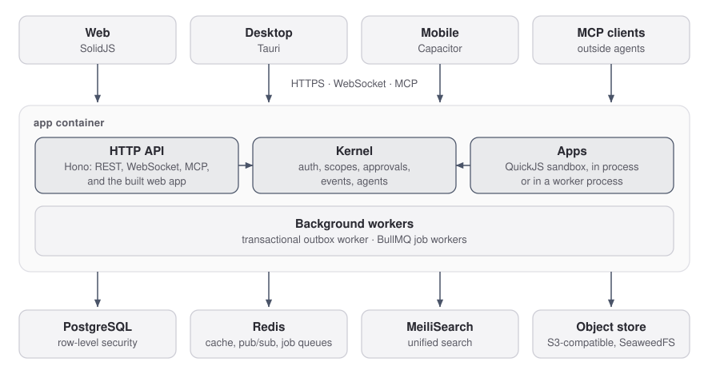

# Liaison

An agent-native business operating system.

Your team's mail, tickets, knowledge, invoicing, shipping and more in one
workspace, with AI agents that work alongside you under the same permissions.
Liaison is modular: anyone can build a new app on its kernel, and MCP works
both ways, so agents can use the tools you already run and outside agents can
work inside Liaison. Agents act through the same tools and access rules as
people — row-level security, not agent judgment, decides what they can see —
and sensitive actions wait for human approval before they execute. Liaison is
self-hosted with Docker Compose (a single image, Postgres, Redis, MeiliSearch,
and an S3-compatible store), with desktop apps for macOS and Windows alongside
the web app.


## Try it without installing

[demo.liaison.sh](https://demo.liaison.sh) gives you your own copy of
**Resonant Audio Labs**, a fictional company with tickets, knowledge,
invoicing and approvals already in it. The agents work out of the box, with no model key
needed. The workspace expires after 72 hours. When you're convinced,
self-host with the quickstart below.

## Set it up with Claude Code or Codex

Clone the repository, open the folder in Claude Code or Codex (the app, VS
Code or the terminal) and ask "set up Liaison for my company":

```bash
git clone https://github.com/mathieufro/liaison.git
```

It follows [the setup playbook](.claude/skills/setup-liaison/SKILL.md)
([AGENTS.md](AGENTS.md) points Codex there): it first asks whether you want a
trial on this machine or a server, and which features you want; it tells you
the plan and the time per step, asks a handful of questions in one go, starts
the stack while you answer, gathers your company's knowledge (your website, the docs in your
git repositories, the manuals and files you point at), shows you what it found,
creates your org, admin, members, AI key and a support agent with
`liaison config apply`, loads the knowledge, walks you through anything that
needs a browser (signing in, Gmail) one step at a time, each with its time
and the option to skip it and come back later, checks that the agent answers from your
knowledge and cites it, and ends with what is done, what is pending and how
long each step took.

Measured on a Mac mini (Apple silicon), setting up Liaison itself (liaison.sh
plus this repository's docs, no mailbox), which is the best case:

| Step | Who | Time |
|---|---|---|
| Plan and prerequisites | agent | 1 s |
| Questions (the stack starts meanwhile) | you | about 5 min |
| Start the stack (during the questions) | agent | 65 to 72 s; the first run builds the image locally, 2 min 19 s, until a release image is published |
| Gather knowledge: 2 web pages, 58 docs from the repo | agent | 13 s |
| Review what was gathered | you | about 2 min |
| Create org, admin, AI keys, `@support` agent, load 60 documents | agent | 5 s |
| Sign in (passwordless code) | you | about 1 min |
| Ask `@support` a question; it answers from the knowledge and cites it | agent | 8 s |
| **Total, best case** | | **about 9 minutes** (small site, no mailbox); the agent's own machine time was 1 min 51 s |

Your agent's own reading and typing comes on top, and a larger website takes an
estimated minute per 100 pages. That is the quick path: about 9 minutes for a trial on your own machine (your knowledge and agents, no mailbox yet, so nobody else can sign in).

The full onboarding sets up the server (domain and https, the mail sender's
SPF, DKIM and DMARC records, Google sign-in, push, backups) and every
connector (Google Workspace, Google Ads, Shopify, Facebook and Instagram,
IMAP, GitLab, Boxtal, Pennylane, webhooks, databases, your own APIs). The
agent prints each console to open, what to click and the exact redirect URIs
and scopes for your server, then applies and checks the values: about 15 minutes for the basic onboarding on a server (the mail sender, Google sign-in, your team, the support inbox and your company knowledge), and
up to about 2 hours of your own time for a full onboarding on a server with every connector, plus the waits some providers impose (Meta's App Review). The
[setup reference](docs/reference/setup.md) has every step and its time.

## Quickstart (one command)

Requires Docker, Docker Compose v2, and `openssl`.

```bash
git clone https://github.com/mathieufro/liaison.git
cd liaison
./deploy/quickstart.sh
```

This generates `deploy/.env` with fresh secrets (never overwriting one that
already exists), pulls the published image if it's reachable or builds it
locally otherwise, brings up Postgres, Redis, MeiliSearch, the bundled
SeaweedFS object store, and the app, and waits for `/healthz` to report every
dependency healthy. It prints the URL and exactly how to log in — open it,
choose **Create an account**, and enter your name and email (plus the one-time setup
token the quickstart prints, also in `docker compose logs app`): the first registration
bootstraps your org and signs you straight in, no password or email
round-trip needed for that one-time step. Every login after that is
passwordless (a code or magic link); without SMTP configured, the quickstart's
`.env` turns on `LIAISON_CONSOLE_EMAIL_BODIES` so the code is written to
`docker compose logs app` instead of emailed. That is for a local trial only:
set `SMTP_*` and remove it before anyone else signs in. It takes about a minute
when the image is cached; the first run builds the image locally (a few
minutes) until a release image is published.

On a remote server, the app listens on the server's loopback only, so the URL
it prints works from there and not from your computer. To try it without a
domain, open a tunnel from your computer and use the same URL in your browser:

```bash
ssh -N -L 3000:127.0.0.1:3000 <user>@<server>
```

Don't publish that port: it speaks plain HTTP. For a domain and https, follow
the runbook below.

Stop the stack and keep your data:

```bash
./deploy/quickstart.sh --down
```

To remove the data permanently: `docker compose -p liaison -f deploy/docker-compose.yml down -v`.

Run `./deploy/quickstart.sh --help` for the rest of the flags (`--port`,
`--pull`, `--build`, `--project`). For a real deployment — TLS, backups,
upgrades, incident playbook — see the
[Production Bootstrap runbook](docs/runbooks/production-bootstrap.md).

## What's inside

**Kernel apps** (in-tree, ship with the platform): mail, tickets, projects,
knowledge, contacts, calendar, a database read connector, an
[API connector](docs/api-connector.md) for your own CRM or ERP (an adapter
file, no code), and connectors for Google Drive and GitLab.

**Bundled apps** (packaged as installable `.liaisonapp`s, same install path a
third-party app would use): `shopify` (orders, customers, products,
fulfillments, returns), `invoicing` (invoices, quotes, proformas, purchase
orders, credit notes), `boxtal` (carrier quotes, tracking, shipments, customs
docs), `pennylane` (accounting: invoices, trial balance, P&L, cash position),
`ads` (Meta Ads, Google Ads, Merchant Center), `social` (Facebook/Instagram/
YouTube monitoring and replies), `calls` (call-transcript ingestion into
knowledge), and `monitoring` (alert ingestion into incidents).

Liaison is built so anyone can write their own plugin app with a stable SDK,
a sandboxed runtime, and a documented install path — see
[Building a Liaison App](docs/app-development.md) (or the `creating-an-app`
Claude skill, if you're pairing with Claude in this repo).

## Architecture

<picture>
  <source media="(prefers-color-scheme: dark)" srcset="docs/assets/architecture-dark.svg">
  
</picture>

- **API** — Bun + Hono in one container: the REST API, WebSocket, MCP and the
  built web app. Installed apps run in a QuickJS sandbox, in process or in a
  worker process.
- **Database** — PostgreSQL with Drizzle ORM. All per-org isolation is
  enforced by row-level security policies, not application code: the runtime
  connection role cannot bypass RLS even if a code path forgets to scope a
  query.
- **Cache / jobs** — Redis for pub-sub and rate limiting; BullMQ for the
  background job queues.
- **Search** — MeiliSearch, rebuildable from Postgres at boot.
- **Object storage** — an S3-compatible API; SeaweedFS ships bundled, or point
  it at Amazon S3 / Cloudflare R2 / any S3-compatible endpoint.
- **Web** — SolidJS + Vite.
- **Desktop** — Tauri shell (macOS, Windows) around the same web app.
- **Mobile** — a Capacitor shell (iOS, Android) around the same web app.

### Stack

| Layer | Technology | Version |
|---|---|---|
| Runtime | [Bun](https://bun.sh) | 1.4 |
| Frontend | [SolidJS](https://www.solidjs.com) | 1.9 |
| Routing | [@solidjs/router](https://github.com/solidjs/solid-router) | 1.0 |
| UI primitives | [Kobalte](https://kobalte.dev) | 0.13 |
| Styling | [Tailwind CSS](https://tailwindcss.com) | 4.3 |
| Build | [Vite](https://vite.dev) | 8.3 |
| Backend | [Hono](https://hono.dev) | 4.13 |
| ORM | [Drizzle ORM](https://orm.drizzle.team) | 0.45 |
| Database driver | [postgres.js](https://github.com/porsager/postgres) | 3.4 |
| Cache / Pub-Sub | [ioredis](https://github.com/redis/ioredis) | 6.0 |
| Job queue | [BullMQ](https://bullmq.io) | 6.3 |
| Auth (JWT) | [jose](https://github.com/panva/jose) | 6.2 |
| Auth (password) | [argon2](https://github.com/ranisalt/node-argon2) | 0.45 |
| Auth (TOTP) | [@oslojs/otp](https://github.com/oslo-project/otp) | 1.x |
| AI | [Vercel AI SDK](https://ai-sdk.dev) | 7.x |
| Validation | [Zod](https://zod.dev) | 4.x |
| Logging | [Pino](https://getpino.io) | 10.3 |
| Formatting / Linting | [Biome](https://biomejs.dev) | 2.5 |
| Testing (backend) | [bun:test](https://bun.sh/docs/test/writing) | built-in |
| Testing (frontend) | [Vitest](https://vitest.dev) | 4.1 |
| Testing (E2E) | [Playwright](https://playwright.dev) | 1.63 |
| Language | [TypeScript](https://www.typescriptlang.org) | 6.0 |

### Project structure

```
liaison/
  package.json              # Bun workspaces root
  tsconfig.json             # Base TypeScript config
  biome.json                # Formatting + linting
  apps/
    web/                    # SolidJS frontend
    api/                    # Hono backend (kernel + in-tree apps)
    db-gate/                # Read-only DB access gateway
    desktop/                # Tauri desktop shell
    mobile/                 # Capacitor mobile shell
  packages/
    shared/                 # Types, Zod schemas, utilities shared between web + api
    app-sdk/                # Plugin app SDK, consumed by bundled apps + 3rd-party apps
    app-ui/                 # Shared UI components for plugin apps
    db-core/                # Shared database primitives
    host-sdk/               # Host-side SDK for embedding Liaison
    test-helpers/           # Shared test utilities, the TestWorld lane handle
  bundled-apps/             # First-party plugin apps, packaged as .liaisonapp and
                            # installed through the same route a 3rd-party app would
                            # use (ads, boxtal, calls, invoicing, monitoring,
                            # pennylane, shopify, social)
  app-catalog/              # Frozen .liaisonapp packages baked into the image
  deploy/                   # docker-compose, quickstart script, config templates
  docs/                     # Runbooks, architecture, provisioning docs
  scripts/                  # Maintenance, build, lint, and dev tooling
```

## Self-hosting in production

The production path — TLS termination, DNS, backups and the restore drill,
rolling upgrades, and an incident playbook — is documented end to end in the
[Production Bootstrap runbook](docs/runbooks/production-bootstrap.md).

You choose how fast you take new versions. The `release` channel (the default)
gets versions promoted from a nightly that has run on the maintainers' instances;
the `nightly` channel gets a signed build of the newest green `main` each day, with
no soak (`./deploy/quickstart.sh --channel nightly`). Migrations only go forward,
so read [Choose a channel](docs/admin/upgrades.md#choose-a-channel) before you
switch.

For headless, config-as-code org provisioning (org, admin, members, BYOK keys,
org API keys, Mail app mailboxes, ticket inboxes, apps, knowledge) from a
single file, see the [Provisioning CLI](docs/provisioning-cli.md)
(`liaison config apply`).

## Development

```bash
# Install dependencies
bun install

# Start PostgreSQL + Redis + MeiliSearch + the object store (docker compose based)
bun run infra:up

# Create and migrate the dev database
bun run db:reset

# Start the dev server (API + frontend); this auto-seeds the QA dataset on first run
bun run dev

# To reseed the dev database later, in a second terminal (dev server must be running):
bun run seed --yes
```

The dev compose stack binds fixed host ports (`5432`, `6379`, `7700`, `9000`),
so it conflicts with another Postgres/Redis/MeiliSearch/object-store stack
already running on those ports on your machine.

| Script | Description |
|---|---|
| `bun run dev` | Start API + frontend dev servers |
| `bun run check` | Biome lint + format check |
| `bun run check:fix` | Biome auto-fix |
| `bun run typecheck` | TypeScript check (all workspaces) |
| `bun run test` | Run all tests (backend + frontend) |
| `bun run test:unit` | Backend unit tests |
| `bun run test:integration` | Backend integration tests |
| `bun run test:e2e` | Backend E2E tests |
| `bun run test:playwright` | Playwright browser E2E tests |
| `bun run db:reset` | Drop + recreate + migrate dev DB |
| `bun run db:reset:test` | Drop + recreate + migrate test DB |
| `bun run db:generate` | Generate Drizzle migration |
| `bun run db:migrate` | Apply migrations |
| `bun run seed` | Seed dev database |
| `bun run app:create <name>` | Scaffold a new plugin app |
| `bun run app:freeze <name>` | Package an in-tree app into a `.liaisonapp` |
| `bun run app:sign <tarball>` | Cosign-sign a `.liaisonapp` package |

See [CONTRIBUTING.md](CONTRIBUTING.md) for the contribution workflow.

## Security

Liaison's agents work under the permissions of the person they act for, and
sensitive actions wait for a person to approve them. Agents still read outside
text that can try to steer them (prompt injection), so read
[Using AI agents safely](SECURITY.md#using-ai-agents-safely) before you connect
real mailboxes, and use a frontier model for agents that handle outside input.
Report vulnerabilities privately as described in [SECURITY.md](SECURITY.md).

## License

Liaison is source-available under the [Functional Source License, Version
1.1, ALv2 Future License](LICENSE) (FSL-1.1-ALv2). In short: you can use,
modify, self-host, and run it for your own internal commercial use, but you
may not offer it (or a substantially similar product) as a competing
commercial product or service. Each release automatically becomes available
under the Apache License, Version 2.0 two years after that release. Read the
full terms in [LICENSE](LICENSE).

External contributions are welcome and gated by a signed [Contributor License
Agreement](CLA.md) — see [CONTRIBUTING.md](CONTRIBUTING.md). Security
disclosures follow [SECURITY.md](SECURITY.md).
